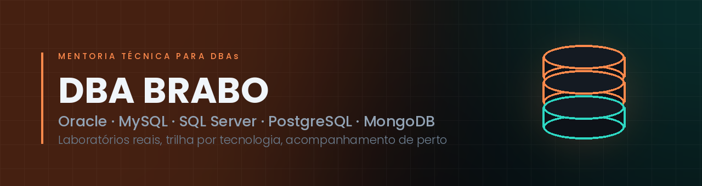

  
  
  
  

---

### Technical mentorship for DBAs · real labs, real production problems

DBA BRABO is a hands-on mentorship program for database administrators in Brazil.
No recorded courses: every track runs on real environments — clusters that fail over,
backups that have to restore, queries that have to get faster — and every lab ends
with a measurable result.

---

## Sobre

A DBA BRABO é uma **mentoria técnica para DBAs**, fundada por
[Acácio Lima Rocha](https://github.com/acaciolr) (Oracle ACE Associate),
[Luis Macedo](https://github.com/luishenriquejm) e Weverton Amorim — DBAs com anos de
estrada em ambientes onde parada custa caro.

Não é curso gravado. É **acompanhamento em cima de ambiente real**, com trilha por
tecnologia: o aluno sobe o cluster, derruba a primária, restaura o backup, acha o
gargalo — e cada exercício termina medindo o resultado, não acreditando na mensagem
do script.

---

## Trilhas

<table>
  <tr>
    <td align="center" width="20%"> RAC, Data Guard, ASM, Exadata, ODA</td>
    <td align="center" width="20%"> InnoDB Cluster, Group Replication, NDB</td>
    <td align="center" width="20%"> Always On, log shipping, replicação, TDE</td>
    <td align="center" width="20%"> Replicação, HA, PITR, pgvector</td>
    <td align="center" width="20%"> Replica set, sharding</td>
  </tr>
</table>

  
  
  
  
  
  

---

## Laboratórios Super DBA

Uma plataforma de laboratório por tecnologia. Cada uma instala **com um comando**, sobe
os nós, configura as instâncias e abre um menu em que cada opção executa operação real
sobre o banco em execução — e termina com `PASS` ou `FAIL`.

### SQL Server Super DBA · `testado em ambiente real`

SQL Server 2022 e 2025 em Linux. Always On com **cluster ativo** (Pacemaker + listener)
em contêineres LXD, log shipping, replicação transacional, backup/restore com PITR,
TDE e TLS, performance guiada e um módulo de **IA no SQL Server 2025** (vetores,
embeddings, RAG, MCP). O aluno conecta o SSMS da própria máquina por túnel SSH.

### PostgreSQL Super DBA · `em homologação`

Replicação, alta disponibilidade, backup/PITR, upgrade, segurança, pooling,
performance, **IA com pgvector** e chaos/recovery em contêineres de sistema LXD.
Currículo de 112 tópicos executáveis: teoria → laboratório → validação.

### MySQL Super DBA · `em homologação`

19 topologias MySQL completas — InnoDB Cluster, Group Replication, NDB, Percona
XtraDB Cluster — com cenários de caos e recuperação para treinar troubleshooting
de verdade.

### Oracle Super DBA · `em desenvolvimento`

VMs reais em Oracle Linux 9 (Vagrant + VirtualBox): RAC de 2 nós com ASM e
*interconnect* privativo, Data Guard, e um grupo de **engineered systems** com
Exadata e ZDLRA.

### MongoDB Super DBA · `em desenvolvimento`

O próximo da fila.

> Os laboratórios são **privados**: o acesso é liberado para os mentorados da DBA BRABO.

---

## Ferramentas abertas

Código aberto, nascido de problema real de produção. Tudo roda no terminal, por SSH,
sem agente e sem servidor web para expor.

### Monitoração no terminal

#### [ORA BRABO](https://github.com/acaciolr/ora-brabo) · `em produção`

*The Dolphie for Oracle. The OEM you can SSH into.* 12 painéis por teclas de função,
cobrindo RAC, Data Guard, ASM e Exadata, com coletores assíncronos.

#### [SQL BRABO](https://github.com/acaciolr/sql-brabo) · `em produção`

*O Activity Monitor que você acessa por SSH.* Monitoramento operacional de SQL Server
no terminal — é o painel que os laboratórios de SQL Server usam para observar os nós.

#### [PG BRABO](https://github.com/acaciolr/pg_brabo) · `em produção`

*The pgAdmin you SSH into.* Cockpit PostgreSQL no terminal: monitoramento,
performance, backup/recovery, replicação, HA e segurança.

### Diagnóstico e operação

#### [ORACLE RECOVERY BRABO](https://github.com/acaciolr/oracle-recovery-database-framework) · `em produção`

Orquestrador de backup, restore e recovery Oracle para Unix, guiado pelo princípio
**descobrir → validar → planejar → mostrar comandos → mostrar riscos** antes de
executar qualquer coisa. Shell POSIX (`ksh`/`sh`), 14 áreas.

#### [BSAR — BRABO Slow Analyze Report](https://github.com/acaciolr/bsar) · `em produção`

Analisador de *slow query log* do MySQL, MariaDB e Percona **no estilo AWR**: agrega
por *fingerprint*, compara períodos e entrega relatório no terminal e em HTML
interativo. Zero dependências externas.

#### [MySQL Export Users](https://github.com/acaciolr/dbabrabo_mysqlexportusers) · `em produção`

Extensão nativa do **MySQL Shell** que exporta usuários, roles e privilégios em SQL
idempotente, gera `REVOKE`s para rollback e auditoria e converte sintaxe
MariaDB → MySQL. Pronto para Git e para replay entre ambientes.

#### [MyBraboSat](https://github.com/acaciolr/mybrabosat) · `em produção`

*Security assessment de MySQL num único `.sql`.* 53 verificações somente leitura —
contas, privilégios, criptografia, configuração, auditoria e LGPD — com severidade,
comando de correção e nota de postura de 0 a 100. HTML autocontido, PDF e texto
para o terminal. É o assessment do menu Security dos laboratórios de MySQL.

---

## Fale com a gente

**[dbabrabo.com.br](https://dbabrabo.com.br)** · [LinkedIn](https://www.linkedin.com/company/dbabrabo) · [@dbabrabo](https://instagram.com/dbabrabo)

**Fundadores:** [Acácio Lima Rocha](https://github.com/acaciolr) (@acaciolr) · [Luis Macedo](https://github.com/luishenriquejm) (@luishenriquejm) · Weverton Amorim

Banco caiu e ninguém sabe por quê? É aqui que a gente aprende a descobrir.

